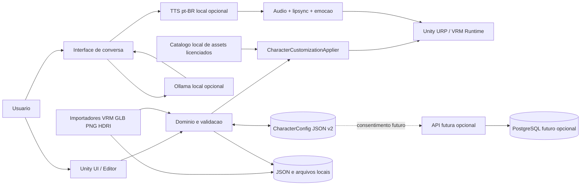
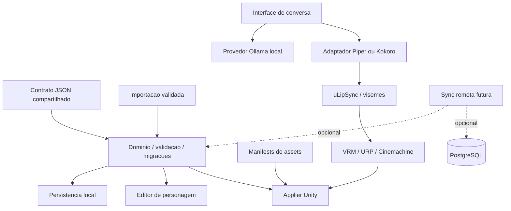

# Mapa do projeto

## Fluxo principal



## Estrutura de pastas

```text
.
|-- docs/
|   |-- ARCHITECTURE.md
|   |-- PROJECT_MAP.md
|   `-- ROADMAP.md
|-- shared/
|   |-- examples/char_lucia_01.json
|   `-- schemas/character.schema.json
|-- unity/
|   |-- Assets/
|   |   |-- Animations/{Dance,Emote,Idle,Poke,Talk}/
|   |   |-- Characters/Lucia/
|   |   |-- Scenes/{Backgrounds,Lighting}/
|   |   |-- Scripts/{Application,Characters,Conversation,Customization,Import,Persistence,Scene,UI,Voice}/
|   |   |-- Shaders/
|   |   |-- Tests/{EditMode,PlayMode}/
|   |   `-- Wardrobe/{Accessories,Clothes,Hair}/
|   |-- Packages/
|   `-- ProjectSettings/
`-- backend/ (opcional, apenas no marco M7)
```

## Dependencias entre modulos



As setas pontilhadas representam servicos opcionais; nao sao pre-requisitos do app local.
